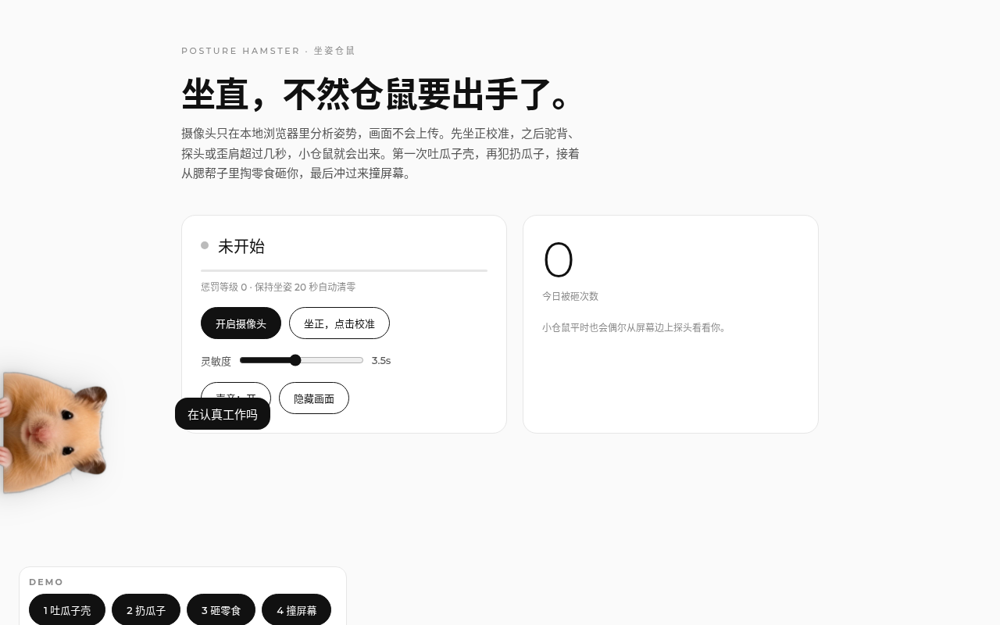
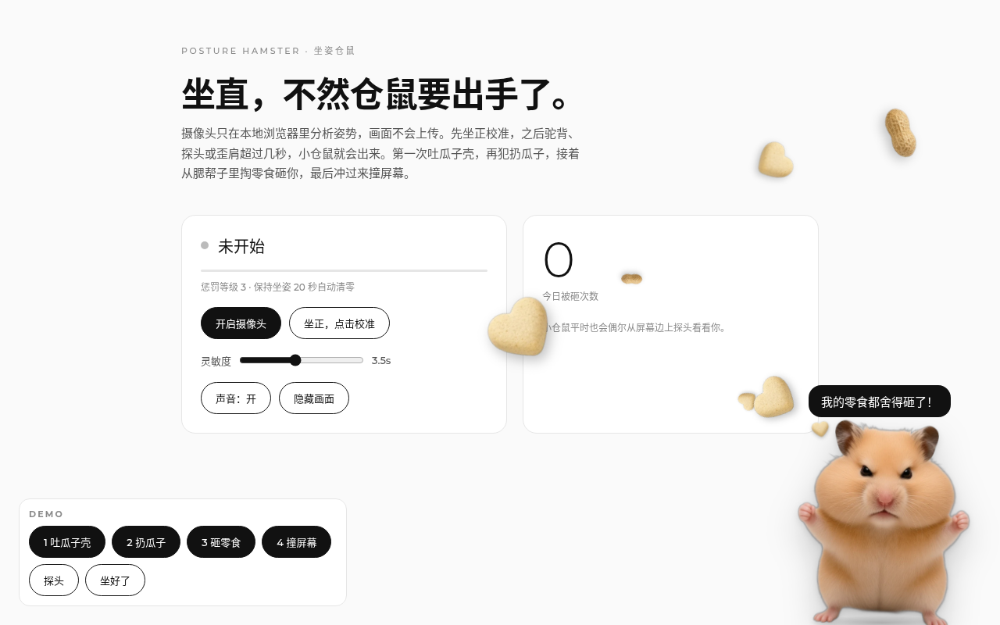
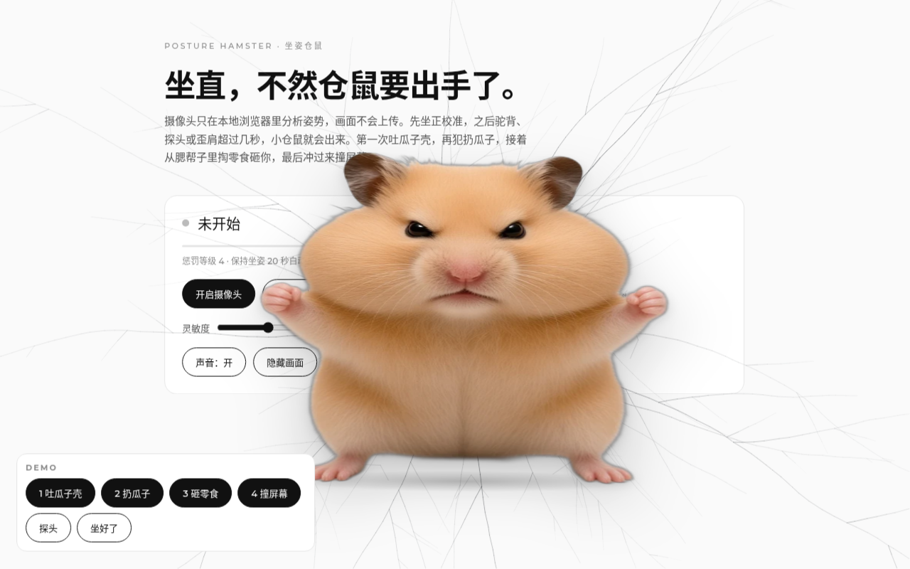

# 坐姿小仓鼠 · Posture Hamster 🐹

> 坐直，不然仓鼠要出手了。

一个 macOS 菜单栏小应用：用摄像头在**本机**检测坐姿，一旦你低头、驼背、凑太近，一只超写实的小仓鼠就会从屏幕边缘不定时探头出来——先吐瓜子壳，再扔更多瓜子和零食，再不改就直接「撞」上你的屏幕。



| 扔瓜子零食 | 撞屏幕 |
|---|---|
|  |  |

## 功能
- 🐹 **随机探头**：仓鼠从左 / 右 / 上 / 下边缘随机出现
- 📈 **逐级升级**：探头提醒 → 吐瓜子壳 → 瓜子连发 → 零食砸屏→ 撞屏幕（玻璃挤压、雾气、裂纹、震屏）
- 🧍 **五种坐姿信号**：低头/驼背、头前伸、靠太近、肩膀歪、身体下沉；坏姿势持续 3 秒才触发
- 🎚️ **灵敏度菜单**：宽松 ×0.5 ～ 严格 ×2，默认「标准」
- 🪟 **透明悬浮层**：始终置顶、鼠标可穿透、所有桌面都在；不占 Dock，只在菜单栏

## 🔒 隐私
所有检测都在你的 Mac 上运行（MediaPipe Pose 模型已打包在应用内），**不联网、不上传、不录像**。摄像头画面只在内存中逐帧分析。

## ⚠️ 先校准！
首次启动会弹出校准窗口：坐好、坐正，点「开始校准」保持几秒。之后所有判断都相对你的「标准坐姿」。
菜单栏显示「未校准」时请先校准；换座位/换显示器后用「清除校准并重新校准」。
觉得太敏感或太迟钝？菜单栏 → 灵敏度；也可打开「显示检测数值」查看实时数据。

## 安装
1. 在 Releases 下载 `坐姿小仓鼠-darwin-arm64.zip`（Apple 芯片）或 `x64`（Intel），解压后拖进「应用程序」。
2. 应用**未签名**，首次打开需二选一：
   - 在 Finder 中右键应用 →「打开」→ 再点「打开」；或
   - 终端执行：`xattr -cr /Applications/坐姿小仓鼠.app`
3. 允许摄像头权限（系统设置 → 隐私与安全性 → 摄像头）。

## 从源码构建
```bash
npm install
npm start                 # 开发运行
npm run build:mac-arm64   # 输出到 dist/
npm run build:mac-x64
```
另有无需安装的网页版：`web/index.html`（需通过本地服务器打开以获取摄像头权限，如 `npx serve web`）。

## 致谢
- [MediaPipe](https://github.com/google-ai-edge/mediapipe) Pose Landmarker（Apache-2.0），见 [THIRD_PARTY_NOTICES.md](THIRD_PARTY_NOTICES.md)
- [Electron](https://www.electronjs.org/)
- 仓鼠形象由作者以自家仓鼠照片为参考 AI 生成

---

## English

**Posture Hamster** is a tiny macOS menu-bar app that watches your posture through the webcam — entirely on-device. Slouch, and a photoreal hamster peeks out from a screen edge, then escalates: spitting seed shells → a growing volley of sunflower seeds & snacks → bonking into your screen.

- Runs locally with MediaPipe Pose; nothing is uploaded or recorded.
- **Calibrate first** (a window opens on first launch). Adjust sensitivity from the menu bar.
- Unsigned build: right-click → Open, or `xattr -cr /Applications/坐姿小仓鼠.app`.
- Build: `npm install && npm run build:mac-arm64` (or `build:mac-x64`).

License: MIT © 2026 Connie Huang. Third-party: MediaPipe (Apache-2.0).
